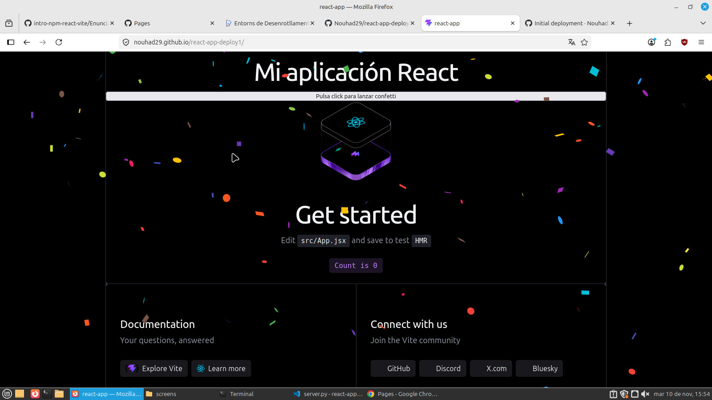
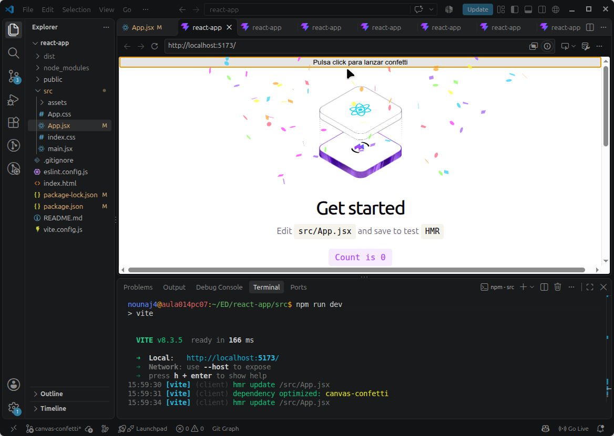
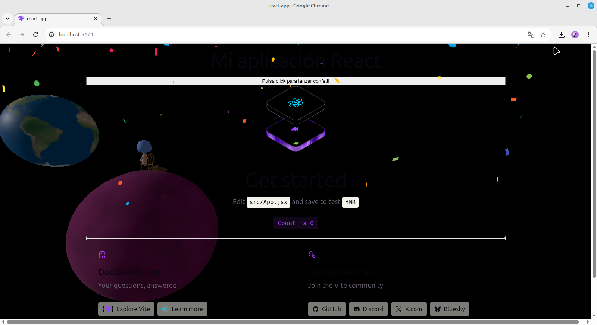

# React App - NPM

## Descripción

Proyecto realizado con React y Vite para practicar la instalación de dependencias, el uso de componentes y el trabajo con ramas en Git.

## Componentes utilizados

- **canvas-confetti:** permite lanzar partículas de confeti al pulsar un botón.
- **Three.js:** permite mostrar una escena 3D como fondo de la página.

## Capturas de pantalla

### 1. React Confetti

### 2. Canvas Confetti

### 3. Escena 3D

## Pregunta

**Si la carpeta `node_modules/` está excluida, ¿borrar una dependencia hace alguna acción sobre el repositorio? ¿Cuál?**

Sí. Aunque `node_modules/` está excluida del repositorio, al eliminar una dependencia con `npm uninstall` se modifican los archivos `package.json` y `package-lock.json`.

Estos cambios sí se guardan en Git mediante un commit. La carpeta `node_modules/` no se sube al repositorio.

## Web desplegada

[Ver proyecto en GitHub Pages]
(https://nouhad29.github.io/react-app-deploy1/)